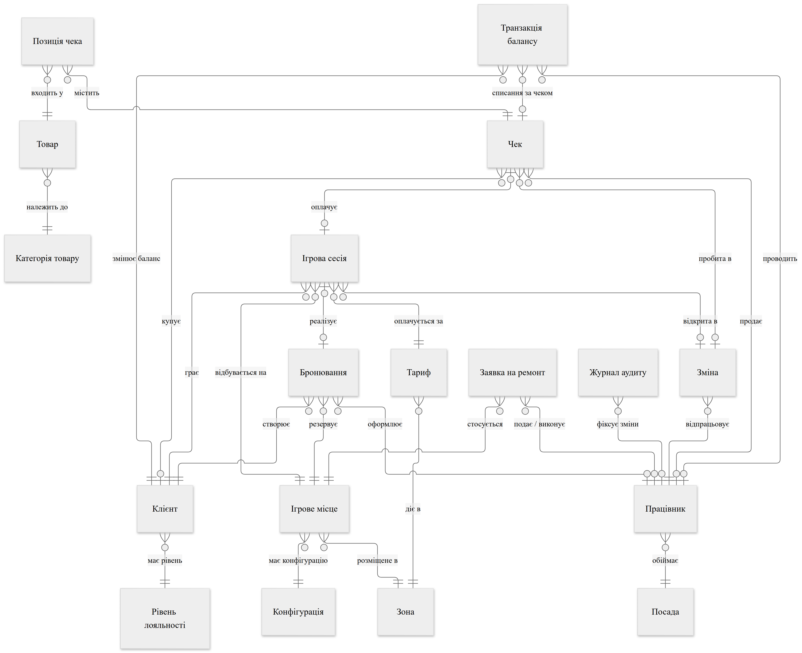
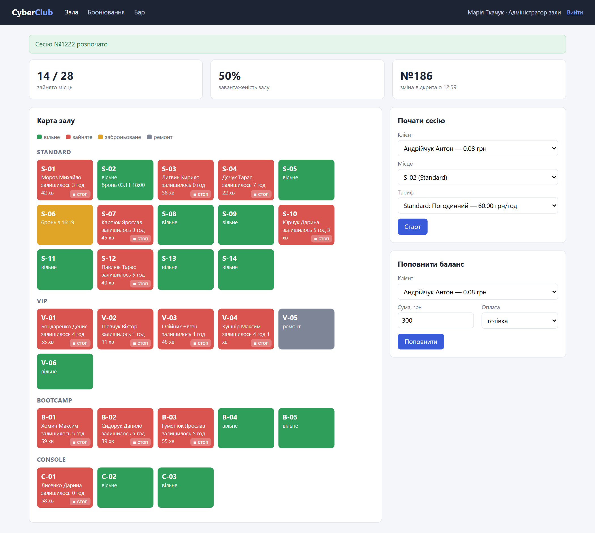
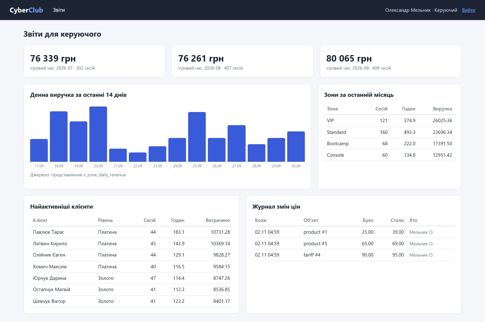
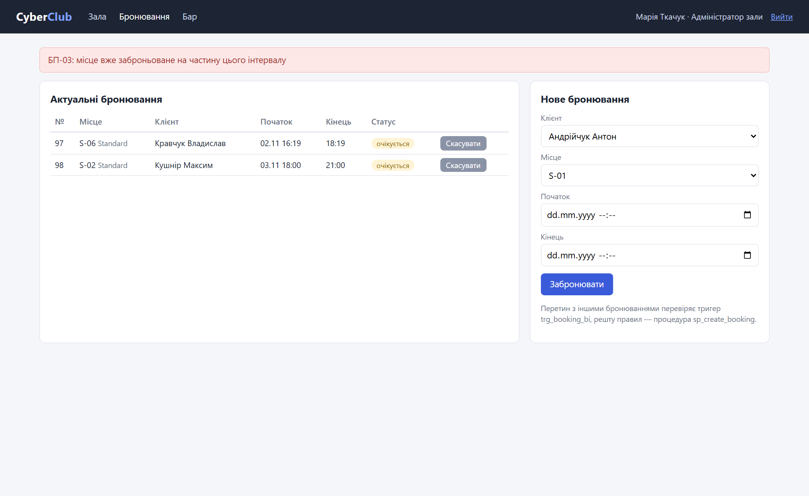
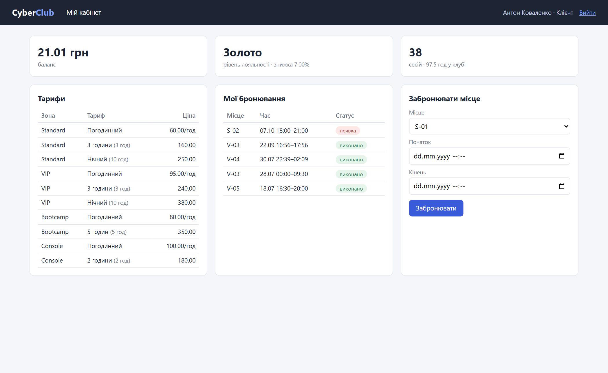

# База даних для автоматизації діяльності комп'ютерного клубу

Курсова робота з дисципліни «Бази даних».
Глодовський Богдан Михайлович, група ІПЗ 3/2, спеціальність 121 «Інженерія програмного забезпечення».
Керівник – Лагоднюк Д. О. Рівне, 2026.

📄 **Пояснювальна записка:** [docs/Kursova_BD_Kompiuternyi_klub.pdf](docs/Kursova_BD_Kompiuternyi_klub.pdf)
📊 **Презентація:** [presentation/Prezentatsiia_Hlodovskyi.pptx](presentation/Prezentatsiia_Hlodovskyi.pptx)

## Що реалізовано

Реляційна база `cyberclub` у MySQL (сумісна з 8.0 / 8.4 LTS / 9.x, перевірено на 9.6) для клубу на 28 місць у чотирьох зонах (Standard, VIP, Bootcamp, Console). Бізнес-правила клубу перевіряє сама СКБД, а не інтерфейс.

| Об'єкт | Кількість |
|---|---|
| Таблиці | 18 |
| Обмеження CHECK | 30 |
| Додаткові індекси | 14 |
| Ролі СКБД | 5 (керуючий, адміністратор зали, технік, застосунок клієнта, адміністратор БД) |
| Функції / процедури | 2 / 5 |
| Тригери | 13 |
| Події планувальника | 1 |
| Представлення | 5 |
| Запити в `07_queries.sql` | 19 (JOIN, підзапити, HAVING, віконні функції, рекурсивний CTE) |
| Тестові дані | 80 клієнтів, 1208 сесій, 1992 транзакції, 1528 чеків (липень–вересень 2026) |

Демонстраційний вебзастосунок на Flask не містить бізнес-логіки: кожна дія – це виклик процедури або SELECT із представлення. Під кожну роль він підключається окремим обліковим записом СКБД.

## Де що лежить

| Шлях | Вміст |
|---|---|
| [`sql/01_schema.sql`](sql/01_schema.sql) | таблиці, ключі, обмеження, індекси |
| [`sql/02_roles.sql`](sql/02_roles.sql) | ролі, привілеї, облікові записи |
| [`sql/03_data.sql`](sql/03_data.sql) | тестові дані (згенеровані `scripts/gen_data.py`) |
| [`sql/04_procedures.sql`](sql/04_procedures.sql) | функції, процедури, подія |
| [`sql/05_triggers.sql`](sql/05_triggers.sql) | тригери |
| [`sql/06_views.sql`](sql/06_views.sql) | представлення |
| [`sql/07_queries.sql`](sql/07_queries.sql) | запити для звітів і приклади DML |
| [`app/`](app/) | вебзастосунок Flask |
| [`img/`](img/) | ER-діаграми, діаграми процесів, скриншоти |
| [`scripts/`](scripts/) | генерація даних, діаграм, скриншотів, записки і презентації |
| [`docs/results.json`](docs/results.json) | фактичні результати запитів, наведені в записці |

## Діаграми та екрани

Концептуальна модель (Crow's Foot):



Повна фізична модель: [img/er_physical.png](img/er_physical.png)

| Карта залу (адміністратор) | Звіти (керуючий) |
|---|---|
|  |  |
| **Бронювання: відмова від тригера** | **Кабінет клієнта** |
|  |  |

## Як запустити

Потрібні MySQL 8.0.16+ і Python 3.11+.

```bash
# 1. База (від імені root; скрипти виконувати по черзі)
mysql -u root -p < sql/01_schema.sql
mysql -u root -p < sql/02_roles.sql
mysql -u root -p < sql/03_data.sql
mysql -u root -p < sql/04_procedures.sql
mysql -u root -p < sql/05_triggers.sql
mysql -u root -p < sql/06_views.sql

# 2. Застосунок
python -m venv .venv
.venv/Scripts/pip install -r requirements.txt      # Linux/macOS: .venv/bin/pip
.venv/Scripts/python app/app.py                    # http://127.0.0.1:5000
```

Застосунок очікує MySQL на `127.0.0.1:3307` (див. `DB` в `app/app.py`). Для стандартного порту змініть його на 3306.

Автор запускав базу окремим екземпляром MySQL (`mysql.ini`, `run_sql.sh`, `build_db.sh`). Шляхи в цих файлах налаштовані під його комп'ютер.

**Тестові облікові записи** (лише для локального демо, не справжні паролі):

| Роль | Логін / пароль |
|---|---|
| Керуючий | `owner` / `owner123` |
| Адміністратор зали | `admin1`…`admin4` / `admin123` |
| Технік | `tech1`, `tech2` / `tech123` |
| Клієнт | логін будь-якого клієнта / `client123` |

Облікові записи СКБД для ролей наведено в `sql/02_roles.sql`.
